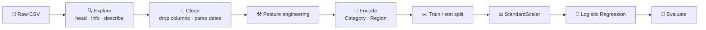

<div align="center">

# 🛒 Superstore Sales Report System

### From raw orders to business insight: cleaning, ML, and a Power BI dashboard in one project.

An end-to-end data workflow that cleans Superstore sales data, engineers new features, trains a model to flag **high-sales orders**, and presents the results in an interactive **Power BI** dashboard.

<br />


[Overview](#-overview) · [Dataset](#-dataset) · [Workflow](#-notebook-workflow) · [ML Goal](#-machine-learning-goal) · [Quick Start](#-quick-start) · [Notes](#-notes)

</div>

---

## 📌 Overview

| | |
|---|---|
| 🧹 **Data cleaning** | Drops unneeded columns, parses dates, and builds a binary `Returned` flag |
| 🛠️ **Feature engineering** | `High Sales`, `Year`, `Month`, `Shipping Days`, `Sales Per Item` |
| 🤖 **Classification** | Logistic Regression predicts whether an order is a high-sales order |
| 📐 **Evaluation** | Accuracy, classification report, confusion matrix, ROC curve, train/test comparison |
| 📊 **Reporting** | Power BI dashboard for sales visualization |

---

## 📁 Project Files

| File | Description |
|---|---|
| `SuperStore_Sales_Dataset.csv` | Raw dataset with **5,901 rows** and **23 columns** |
| `cleaned_superstore .csv` | Cleaned, feature-engineered dataset with **5,901 rows** and **25 columns** |
| `Sales_Report_System.ipynb` | Notebook for cleaning, feature engineering, training, and evaluation |
| `Superstore Sales DashBoard.pbix` | Power BI dashboard for sales reporting |

---

## 🗃️ Dataset

Order-level sales records covering customers, products, geography, shipping, returns, payments, and profit.

| Group | Fields |
|---|---|
| 📅 **Dates** | `Order Date`, `Ship Date` |
| 🚚 **Shipping** | `Ship Mode` |
| 👤 **Customer** | `Customer Name`, `Segment` |
| 🌍 **Location** | `Country`, `City`, `State`, `Region` |
| 📦 **Product** | `Category`, `Sub-Category`, `Product Name` |
| 💰 **Financials** | `Sales`, `Quantity`, `Profit` |
| ↩️ **Other** | `Returns`, `Payment Mode` |

---

## 🧭 Notebook Workflow



<details>
<summary><b>Step-by-step breakdown</b></summary>

<br />

1. Import analysis, visualization, and machine learning libraries
2. Load the raw dataset from `SuperStore_Sales_Dataset.csv`
3. Explore with `head()`, `info()`, `describe()`, and missing-value checks
4. Clean by removing unnecessary columns and converting date fields
5. Convert return information into a binary `Returned` feature
6. Create new features: `High Sales`, `Year`, `Month`, `Shipping Days`, `Sales Per Item`
7. Encode categorical variables such as `Category` and `Region`
8. Split the data into training and testing sets
9. Scale numeric features with `StandardScaler`
10. Train a Logistic Regression model
11. Evaluate with accuracy, classification report, confusion matrix, ROC curve, and a train/test accuracy comparison

</details>

---

## 🎯 Machine Learning Goal

A **binary classification** task: predict whether an order belongs to the `High Sales` class.

`High Sales` is defined by comparing each order's `Sales` value against the median:

```python
df["High Sales"] = np.where(df["Sales"] > df["Sales"].median(), 1, 0)
```

Because the median is the cutoff, the two classes are balanced by construction.

---

## ⚡ Quick Start

### 1. Install dependencies

```bash
pip install pandas numpy matplotlib seaborn scikit-learn jupyter
```

> 📊 **Power BI Desktop** is required to open and edit the `.pbix` dashboard.

### 2. Launch Jupyter

```bash
jupyter notebook
```

### 3. Run the notebook

Open `Sales_Report_System.ipynb` and run the cells from top to bottom.

### 4. View the dashboard

Open `Superstore Sales DashBoard.pbix` in Power BI Desktop.

---

## 📝 Notes

- The raw CSV is read with Latin-1 encoding:

  ```python
  pd.read_csv("SuperStore_Sales_Dataset.csv", encoding="latin1")
  ```

- The cleaned CSV filename currently has a space before the extension: `cleaned_superstore .csv`.
- The final notebook cell that exports the cleaned CSV is commented out. Uncomment it and adjust the filename if needed:

  ```python
  df.to_csv("cleaned_superstore.csv", index=False)
  ```

---

## 🎓 What This Project Demonstrates

- ✅ Data understanding
- ✅ Data cleaning
- ✅ Feature engineering
- ✅ Classification modeling
- ✅ Model evaluation
- ✅ Business dashboard reporting

---

<div align="center">

**If you found this useful, consider giving it a ⭐**

</div>
